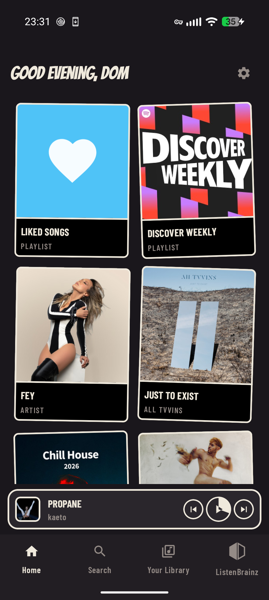
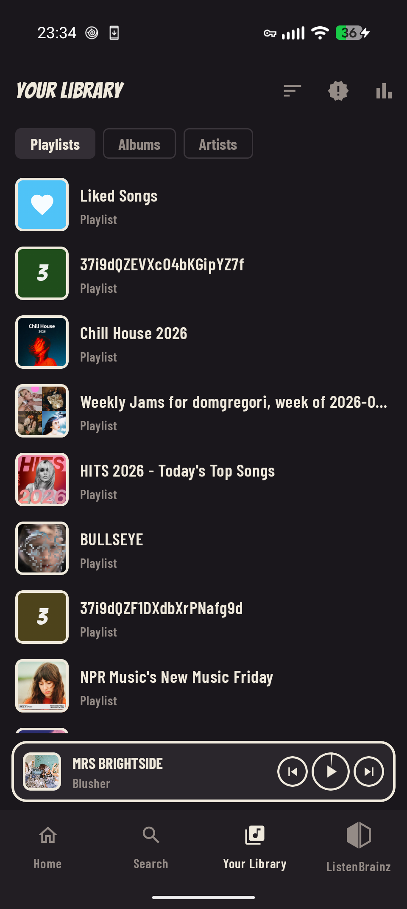
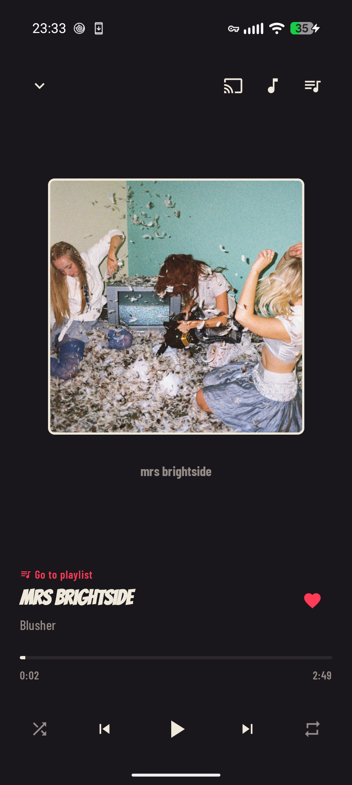
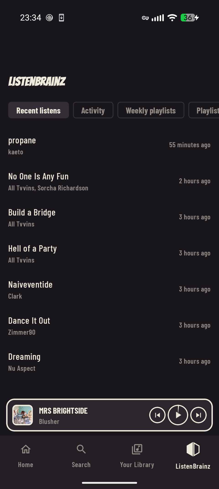
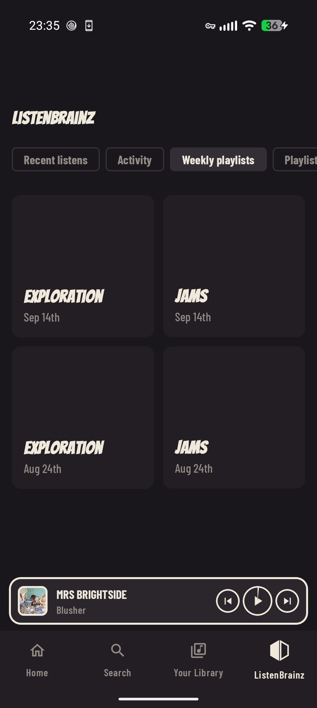
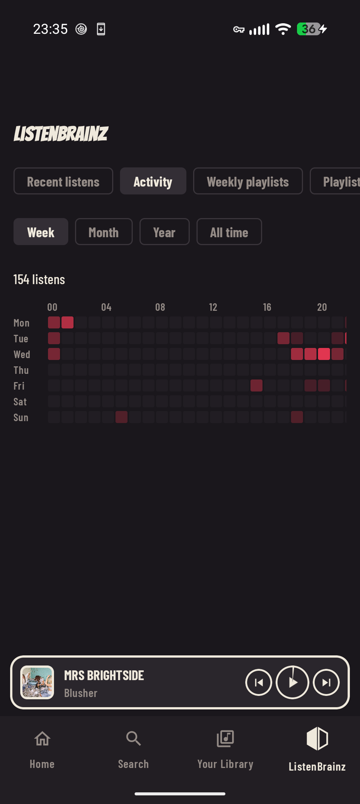

<p align="center">
  
</p>

<h1 align="center">Spotifast for Android</h1>

<p align="center"><strong>Spotify, native and fast — now in your pocket.</strong><br>An unofficial Android client built on Spotifast's own Rust core.</p>

<p align="center">
  <a href="../Cargo.toml"></a>
  <a href="build.gradle.kts"></a>
  <a href="../LICENSE"></a>
</p>

Spotifast for Android reuses [Spotifast's](../README.md) Rust core —
the same [librespot](https://github.com/librespot-org/librespot)-based
playback engine and Web API client that power the desktop app — behind a
Jetpack Compose interface built for a phone. It talks to Spotify Connect
directly, so it plays locally or hands off to any other Connect device,
and it goes further than a typical client with deep
[ListenBrainz](https://listenbrainz.org) integration: weekly recommendation
playlists, an LB Radio playlist generator, a personalized fresh-releases
feed, and a listening-activity heatmap, all native to the app rather than
bolted on.

**Playback needs Spotify Premium.** Free accounts can browse and search, but
cannot play music.

<p align="center">
  
  
  
</p>

## What's here

| Feature | What you can do |
|---|---|
| **Library and search** | Browse playlists, Liked Songs, albums, artists, and podcasts. Search the catalogue, and create, save, or delete playlists. |
| **Spotify Connect** | Play on this phone or hand off to any other Connect device — speakers, the desktop app, other phones. |
| **ListenBrainz** | Weekly Jams and Weekly Exploration as a playlist grid, an LB Radio generator (from an artist, a genre, or your own stats), a personalized Fresh Releases feed, and a daily listening-activity heatmap. See [LISTENBRAINZ_FEATURES.md](LISTENBRAINZ_FEATURES.md) for the full list. |
| **Media session** | Lock-screen and Bluetooth playback controls, including a one-tap Liked Songs heart right next to play/pause. |
| **Comic Noir theme** | A second, hand-drawn visual identity — bold display type, inked borders, a dedicated monochrome app icon for Android's Themed Icons — alongside the default theme. |
| **Caching** | Playlists, cover art, and recently played audio are cached for offline-friendly scrolling and instant resumes; cached audio ages out automatically after 30 days, and Settings has a one-tap "Clear Cache". |

<p align="center">
  
  
  
</p>

## Install

There's no Play Store listing yet — build from source and sideload the APK:

```sh
cd android
./gradlew :app:assembleDebug
# APK lands at app/build/outputs/apk/debug/app-debug.apk
```

A release build needs a signing config; see
[`app/build.gradle.kts`](app/build.gradle.kts). The Rust core builds as
part of the Gradle build via `cargoNdkBuild` — no separate step needed,
just the Android NDK and a Rust toolchain with the Android targets
installed.

## Start listening

1. Open the app and sign in with Spotify. Library access and local
   playback are separate approvals, same as the desktop app — see
   [How it connects](https://spotifast.rocks/how-it-connects/) for the
   details that still apply here.
2. To play on this phone, tap the mini player and authorize playback when
   prompted. Your phone appears as a Spotify Connect device.
3. Optional: connect a [ListenBrainz](https://listenbrainz.org) account in
   Settings to unlock the Weekly Playlists, LB Radio generator, Fresh
   Releases, and Activity tabs.

## Themes and app icon

Switch between the default theme and Comic Noir — and between the matching
Indigo and Comic launcher icons — in Settings. The Comic icon also ships a
dedicated monochrome layer, so it renders correctly when Android's
**Themed icons** setting is on.

## Relationship to the desktop app

This app is a Jetpack Compose frontend over the same `core/` crate the
desktop app uses (see the [repository root](../README.md) and
[`core/`](../core)), kept portable on purpose — new Web API or playback
logic lives there once and both apps get it. The Android-specific pieces
are the UI (`app/src/main/kotlin/rocks/spotifast/android/`), the UniFFI
bridge (`rust/`), and the ListenBrainz integration, which is Android-only
for now.

## Acknowledgements

Like the desktop app, Spotifast for Android uses
[librespot](https://github.com/librespot-org/librespot) for playback and
is an independent project, not affiliated with Spotify or ListenBrainz.
Spotify is a trademark of Spotify AB.

Licensed under the [MIT License](../LICENSE).
